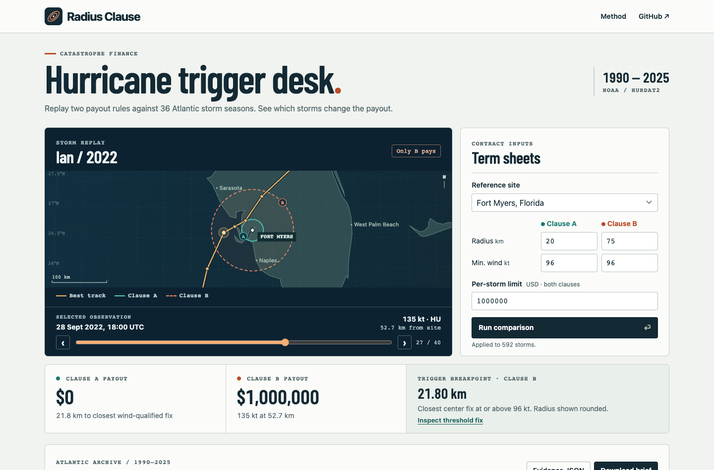

# Radius Clause

**Which hurricane observation changes a million-dollar payout?** Radius Clause lets a broker or analyst compare two hypothetical cat-in-a-circle contracts at one coastal site. Change the radius or minimum wind, replay the storm, and trace each payment to a dated NOAA fix.

[Open the live workbench](https://dylanlaewe.github.io/radius-clause/) · [Read the opportunity research and pilot economics](./RESEARCH.md)



## Try the Fort Myers case

Open the desk to see Hurricane Ian in 2022. Both clauses require at least 96 kt and have a $1 million per-storm limit. At Fort Myers, a 20 km radius pays $0 and a 75 km radius pays $1 million. The first qualifying radius is 21.795 km. NOAA recorded a 125 kt storm center at 20:35 UTC on September 28. The strongest fix within the wider circle was a different observation, at 135 kt and 52.65 km. [NHC Hurricane Ian report, table 1](https://www.nhc.noaa.gov/data/tcr/AL092022_Ian.pdf)

The archive contains 592 storms and 17,820 center fixes. With the opening rules, A triggers for zero storms and B triggers for two. Narrow or widen the radius, then choose **Run comparison**. **Inspect threshold fix** jumps to the closest recorded storm center that met Clause B’s minimum wind. The number beside the slider is the position in that storm’s full track.

- Compare five preset sites or enter latitude and longitude. The browser shares a site and limit across both clauses. The CLI accepts independent rules.
- Use the event ledger to find storms that triggered one wording, both, or neither. Select a storm to inspect it on the map. The sensitivity grid sweeps seven radii and seven wind thresholds.
- Paste site losses using `storm_id,loss_usd`. An explicit zero is a measured zero. Missing storms remain unknown. The desk computes loss above payout and payout above loss independently. Changing sites clears the records.
- Download a standalone HTML brief for printing or a JSON evidence file with both rules, annual totals including empty years, event-level results, observation times, and data provenance. Applied loss records enter the JSON. The brief includes their aggregate results. The static app processes inputs in browser memory.

## Run locally

Node 20+ runs the engine, CLI and tests. Python 3 serves the browser app. The project has no runtime packages to install.

```sh
npm test
npm start
```

Open [the local workbench](http://127.0.0.1:4173/). To compute comparisons from a terminal, use:

```sh
node scripts/replay.mjs --help
node scripts/replay.mjs --example > report.json
node scripts/replay.mjs --rules example-rules.json > fort-myers.json
```

The supplied sample reproduces the opening pair. The shared engine is in [site/engine.mjs](./site/engine.mjs). To run the optional desktop and mobile acceptance check against a running site, make Playwright available to Node, install Chrome, then run `node scripts/browser-check.cjs http://127.0.0.1:4173/`.

## Model

A recorded NOAA center fix qualifies when its status is `HU` or `TS`, its storm-wide maximum sustained wind reaches the threshold in knots, and its great-circle distance from the site is within the selected radius. Both boundaries are inclusive. A qualifying storm pays the full per-storm limit once. The two calculations retain the strongest qualifying fix and the closest wind-qualified fix, even if the latter is outside the circle. The track line is a visual connection between observations. Only the archived points enter the comparison.

The fixed sample covers the 36 Atlantic seasons from 1990 through 2025. The model has no annual aggregate cap, reinstatement, time-dependent climate adjustment, local wind model or loss estimator. The figures are hypothetical historical payments. Actual policies can have materially different status definitions, interpolation, data cutoffs and loss requirements. A changed binary trigger alone cannot measure basis risk. A site loss series can reveal historical mismatches within the supplied observations.

## Data and reproducibility

To reconstruct both bundled data files from the pinned releases, run `python3 scripts/build_data.py`. Each download is checked against its original SHA-256 digest. The map uses a site-centered azimuthal equidistant projection, so a circle’s plotted radius matches the spherical distance calculation. The simplified coastline covers the Atlantic basin and neighboring land. The browser ships the archive and map geometry with the app. The preparation script records the source version and hash. The coastline is only for cartographic context. Barlow Condensed is distributed with its [font license](./site/fonts/OFL.txt). See the [data preparation script](./scripts/build_data.py), [NOAA HURDAT2 archive](https://www.nhc.noaa.gov/data/) and [Natural Earth public-domain terms](https://www.naturalearthdata.com/about/terms-of-use/).

GitHub Actions runs the test suite and a CLI replay before publishing the contents of `site/` to GitHub Pages.
